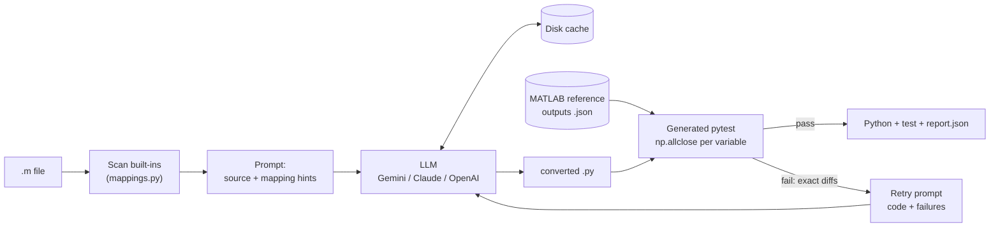

# MATLAB → Python Agent

An LLM agent that converts MATLAB `.m` scripts to Python (NumPy / SciPy / Matplotlib). It **checks its own work** by comparing every output variable with values saved from a real MATLAB run, and **retries using the exact test failures** when the numbers don't match.

## Problem

Teams moving off MATLAB often have hundreds of analysis scripts. Translating them by hand is slow, and translating them with an LLM fails in quiet ways. The Python runs, but the answers are slightly wrong. Common causes:

- 1-based vs 0-based indexing
- column-major `reshape` and `(:)`
- different default behaviour between equivalent functions, such as `filtfilt` edge padding
- `ode45` vs `solve_ivp` output shapes

Code that looks right is not good enough. You need numerical proof.

## Approach

1. **Reference outputs from real MATLAB.** `tools/make_references.py` runs each sample in MATLAB (R2025b) and saves the chosen workspace variables to JSON. These files are committed, so MATLAB is not needed after that.
2. **Targeted prompt.** The agent scans the `.m` file for known built-ins and adds only the relevant rows of a 50-function mapping table, including the known pitfalls, to the prompt.
3. **Annotated conversion.** The LLM must keep variable names and tag each translated line with `# MATLAB: <function> -> <python>`. The agent verifies that the tags are there ("comment coverage").
4. **Generated test.** The agent writes a standalone `pytest` file that runs the converted script and compares each variable with `np.allclose`. Tolerances can be set per variable. For plots, it also checks that the output files were written and that each subplot has the right number of lines.
5. **Retry with feedback.** On failure, the next prompt contains the previous code plus the failing checks, for example `B: max abs error 6.0; got=[1 2 3 4] expected=[1 4 7 10]`. The default is at most 3 attempts.



## Results

These are real runs of `python evaluate.py` on the 5 bundled samples, all checked against MATLAB R2025b outputs. Default tolerance: `rtol=1e-6, atol=1e-9`.

**Live LLM: `gemini-3.5-flash-lite`** (6 API calls in total)

| Sample | Checks | Attempt 1 | Final | Attempts | Comment coverage |
|---|---|---|---|---|---|
| signal_filtering | 7/7 | pass | **pass** | 1 | 100% |
| fft_analysis | 7/7 | pass | **pass** | 1 | 100% |
| matrix_ops | 15/15 | pass | **pass** | 1 | 100% |
| ode_solving | 6/6 | fail (script crashed) | **pass** | 2 | 100% |
| plotting | 10/10 | pass | **pass** | 1 | 100% |

**First-attempt pass rate: 4/5 (80%). After retries: 5/5 (100%).**

`ode_solving` failed on its first attempt because the model left MATLAB indexing in the code (`Y(0, :)`), which is a `SyntaxError`. The agent passed that error back to the model, and the second attempt passed all checks.

**Mock mode** (`--mock`, 0 API calls). The canned replies include two realistic first-attempt bugs so that the retry path is exercised:

| Sample | Attempt 1 | Final | Bug planted in attempt 1 |
|---|---|---|---|
| signal_filtering | fail (3 checks) | **pass** (2 attempts) | SciPy's default `filtfilt` padding (max error 0.053 at the edges vs MATLAB) |
| fft_analysis | pass | **pass** | – |
| matrix_ops | fail (5 checks) | **pass** (2 attempts) | row-major `reshape` instead of `order='F'` |
| ode_solving | pass | **pass** | – |
| plotting | pass | **pass** | – |

**First-attempt pass rate: 3/5 (60%). After retries: 5/5 (100%).**

Unit tests: `pytest`, 10 passed.

Full per-attempt details are in [results/](results/).

## How to run

```bash
python -m venv .venv && .venv\Scripts\activate      # Python 3.12
pip install -r requirements.txt
cp .env.example .env                                 # add GEMINI_API_KEY (or another provider)

# Command line
python cli.py samples/matrix_ops.m --mock            # no API calls
python cli.py samples/matrix_ops.m                   # real LLM; output in out/matrix_ops/
python cli.py my_script.m --reference my_outputs.json --max-attempts 3

# Evaluate all samples
python evaluate.py --mock
python evaluate.py            # served from the committed cache/llm/, so no API calls

# UI
streamlit run app.py

# Tests
pytest
```

**Provider selection:** set `LLM_PROVIDER=gemini|anthropic|openai` and, optionally, `LLM_MODEL` in `.env`, or pass `--provider` / `--model`.

**Your own scripts:** create the reference JSON in MATLAB with
`fid=fopen('ref.json','w'); fprintf(fid,'%s',jsonencode(struct('y',y,'z',z))); fclose(fid);`
Without a reference, the agent falls back to a smoke test that only checks the script runs without errors.

**Output per file** (`out/<name>/`): `<name>.py`, `test_<name>.py` (standalone; runs with `pytest`), `attempt_N.py` for each attempt, and `report.json`.

### Bundled samples (written from scratch; free to share)

| File | Covers |
|---|---|
| `signal_filtering.m` | `butter`, `filter`, `filtfilt`, `finddelay` |
| `fft_analysis.m` | `fft`, single-sided spectrum, `findpeaks`, Parseval check |
| `matrix_ops.m` | `\`, `inv`, `det`, `eig`, `kron`, column-major `reshape` / `(:)`, `end` indexing, `.*` vs `*` |
| `ode_solving.m` | Hand-written RK4 loop, `ode45` + `odeset`, analytic comparison |
| `plotting.m` | `subplot`, `plot`, `legend`, `saveas`, `trapz`, `max` with index |

## Project structure

```
agent/
  agent.py       convert -> test -> retry loop, writes report.json
  converter.py   system prompt, first/retry prompts, code extraction
  tester.py      pytest template, runner, JUnit XML parsing
  mappings.py    MATLAB->Python table, function scanner, comment check
  llm.py         Gemini/Anthropic/OpenAI client, disk cache, mock mode
samples/         5 .m files, specs.json (which variables, tolerances), references/ (MATLAB outputs)
mock_responses/  canned LLM replies for --mock
tools/           MATLAB reference exporter
cli.py  app.py  evaluate.py  tests/
```

## Limitations

- **Testing needs reference values.** Numerical checks require a MATLAB run, done once, to produce the reference JSON. Without it, the agent can only confirm the script runs.
- **Scripts only, not functions or toolboxes at scale.** One `.m` script at a time. Multi-file projects, `function` files, classes, Simulink, and toolboxes without a SciPy equivalent are out of scope.
- **Deterministic inputs only.** `rand`/`randn` streams differ between MATLAB and NumPy, so scripts that use them need fixed seeds plus saved inputs, or statistical tolerances.
- **Adaptive solvers.** `ode45` and `solve_ivp` choose different internal steps. The sample compares endpoint values at tight tolerances, not the step grids.
- **Small evaluation set.** 5 samples, a single run with temperature 0. This shows that the loop works, not that it would reach 100% on real-world code.
- **Executes generated code.** Converted scripts run locally in a subprocess with no sandbox. Only convert code you trust.
- **Coarse syntax-error feedback.** A crash is reported to the model as a traceback summary without the exact line. Pre-checking with `ast.parse` would give it the line number.
